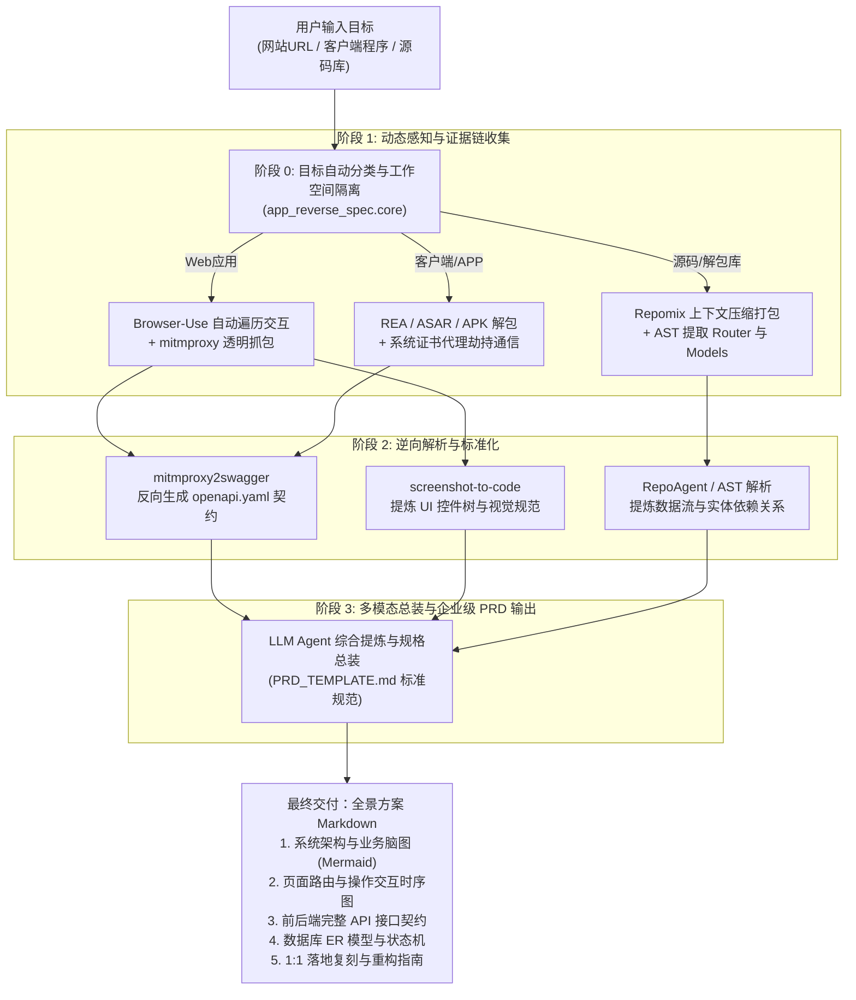

# App-Reverse-Spec (全栈应用逆向与全景方案生成工作流)

<p align="center">
  <b>端到端软件与网站逆向分析器：一键输入目标，直接输出 UI/UX 交互图谱、后端 API 契约、状态流转与可落地的全景 PRD 蓝图</b>
</p>

<p align="center">
  <a href="#-流程来源与开源致敬-attributions"></a>
  <a href="LICENSE"></a>
  <a href="#-支持的目标类型"></a>
  <a href="skills/app-reverse-spec"></a>
</p>

---

## 📖 项目简介 (Overview)

在日常开发、竞品调研、架构重构或安全审计中，开发者常常需要深入理解一款现有软件或网站：
- 它有哪些 UI 页面与控件？
- 用户触发某个按钮时，前后端经历了怎样的交互？
- 后端有哪些未公开的 REST/RPC 接口？入参和响应的数据结构是什么？
- 数据库底层是如何建模的？核心业务状态机如何流转？

目前业内存在许多优秀的单一维度工具（例如仅抓包的、仅爬虫的、仅代码打包的），但**缺乏一套将它们编排成工业级闭环流水线的框架**。

**App-Reverse-Spec** 综合集成了全球开源社区在**多模态探索、透明流量拦截、协议推导与代码打包**领域的顶尖项目，并封装为统一的 CLI 调度工具与 Agent Skill。无论输入的是**在线网站 URL、客户端安装包（.exe / .asar / .apk）还是开源代码仓库**，均能自动规划并执行逆向流水线，最终产出符合企业级标准的全景方案与落地 PRD。

---

## 🏆 流程来源与开源致敬 (Attributions)

本项目绝非凭空产生，而是站在全球优秀开源项目的肩膀上完成的工程化综合集成。**本项目各阶段流水线的核心技术来源如下**：

| 流水线阶段 | 核心任务 | 集成的上游开源项目 | 作者 / 组织 | 开源协议 |
| :--- | :--- | :--- | :--- | :--- |
| **1. 协议逆向** | 网络抓包自动逆向生成 OpenAPI 3.0 / Swagger | [mitmproxy2swagger](https://github.com/alufers/mitmproxy2swagger) | [@alufers](https://github.com/alufers) | MIT |
| **2. 流量拦截** | 客户端/Web 透明 SSL 中间人抓包与监听 | [mitmproxy](https://github.com/mitmproxy/mitmproxy) | mitmproxy org | MIT |
| **3. UI 自主探索** | 基于视觉与 DOM 的浏览器自主巡检与操作 | [Browser-Use](https://github.com/browser-use/browser-use) | Browser Use Team | MIT |
| **4. 移动端探索** | 移动 GUI 自主两阶段探索与知识图谱构建 | [AppAgent](https://github.com/TencentQQGYLab/AppAgent) | 腾讯 QQGYLab | Apache-2.0 |
| **5. 桌面端感知** | 端到端桌面原生 GUI 视觉感知与动作规划 | [UI-TARS](https://github.com/bytedance/UI-TARS-desktop) | 字节跳动 (ByteDance) | Apache-2.0 |
| **6. 视觉规范提炼** | 截屏反向解析为前端组件树与 Tailwind 规范 | [screenshot-to-code](https://github.com/abi/screenshot-to-code) | [@abi](https://github.com/abi) | MIT |
| **7. 仓库上下文打包**| 全栈代码库上下文极致压缩与结构化打包 | [Repomix](https://github.com/yamadashy/repopack) | [@yamadashy](https://github.com/yamadashy) | MIT |
| **8. 代码依赖分析** | 仓库级 AST 代码全局依赖与文档自动维护 | [RepoAgent](https://github.com/OpenBMB/RepoAgent) | OpenBMB / 清华团队 | Apache-2.0 |
| **9. 混合客户端逆向**| 针对 JS/Electron/PE 的结构解包与行为证据包 | [REA](https://github.com/morluto/rea) | [@morluto](https://github.com/morluto) | MIT |
| **10. 需求规范标准**| 生产级 PRD 架构蓝图规约与质量核对标准 | [prd-generator](https://github.com/scalershare/prd-generator) | Scalershare | MIT |

> 详细的各模块来源说明、许可证与调用方式见 [ATTRIBUTIONS.md](ATTRIBUTIONS.md)。

---

## ⚡ 核心架构流水线 (Architecture Pipeline)



---

## 📦 安装与快速开始 (Getting Started)

### 1. 克隆仓库与安装依赖
```bash
git clone https://github.com/your-username/app-reverse-spec.git
cd app-reverse-spec

# 安装 Python 基础依赖
pip install -e .

# 可选：安装核心底层工具链
pip install mitmproxy mitmproxy2swagger playwright
playwright install
npm install -g repomix
```

### 2. 作为 CLI 命令行工具使用

#### 探测并规划 Web 网站：
```bash
app-reverse-spec analyze "https://example.com/app"
```

#### 探测本地客户端或源码目录：
```bash
app-reverse-spec analyze "D:/path/to/my-electron-app.asar"
# 或
app-reverse-spec analyze "./my-source-code-dir"
```

#### 查看开源致敬列表：
```bash
app-reverse-spec attributions
```

---

## 🤖 作为 Antigravity / Claude Agent 技能使用

本项目原生支持作为 **Antigravity / Cursor / Claude Code** 技能运行：

1. 将 `skills/app-reverse-spec` 目录复制到您的全局或工作区技能目录中：
   - 全局路径：`~/.gemini/config/skills/app-reverse-spec/`
   - 项目路径：`.agents/skills/app-reverse-spec/`
2. 在对话中直接告诉 Agent：
   > “请帮我分析目标网站 `https://xxx.com`，使用 app-reverse-spec 技能输出完整全景方案。”
3. Agent 将自动激活该技能，调度工具链并按照六大规范章节生成高保真方案！

---

## 📑 交付方案标准（输出内容概览）

输出的方案规范严格遵循 [`skills/app-reverse-spec/references/PRD_TEMPLATE.md`](skills/app-reverse-spec/references/PRD_TEMPLATE.md)，包含：

- **1. 系统业务定位与功能全貌**：业务痛点、核心价值、功能矩阵脑图、核心业务逻辑流。
- **2. UI/UX 交互与用户旅程**：页面路由表、核心交互时序图（Mermaid Sequence）、组件设计系统。
- **3. 前端工程与技术架构**：原技术栈判定、现代化推荐选型、状态管理与客户端缓存流。
- **4. 后端架构与接口协议**：鉴权流程、基于 OpenAPI 提炼的完整请求路径、参数与响应 Schema。
- **5. 数据实体模型与状态机**：实体关系图（Mermaid ER）、对象生命周期状态机。
- **6. 1:1 落地复刻与重构实施方案**：现代化架构清单、4 阶段 Sprint 排期、关键技术攻坚指南。

---

## 🤝 贡献与开源许可

- 本项目采用 [MIT License](LICENSE) 开源协议。
- 各集成模块的版权与许可归属于各自的上游作者与团队，请参阅 [ATTRIBUTIONS.md](ATTRIBUTIONS.md)。
- 欢迎提交 Issue 与 Pull Request 共同完善逆向工具链生态！
