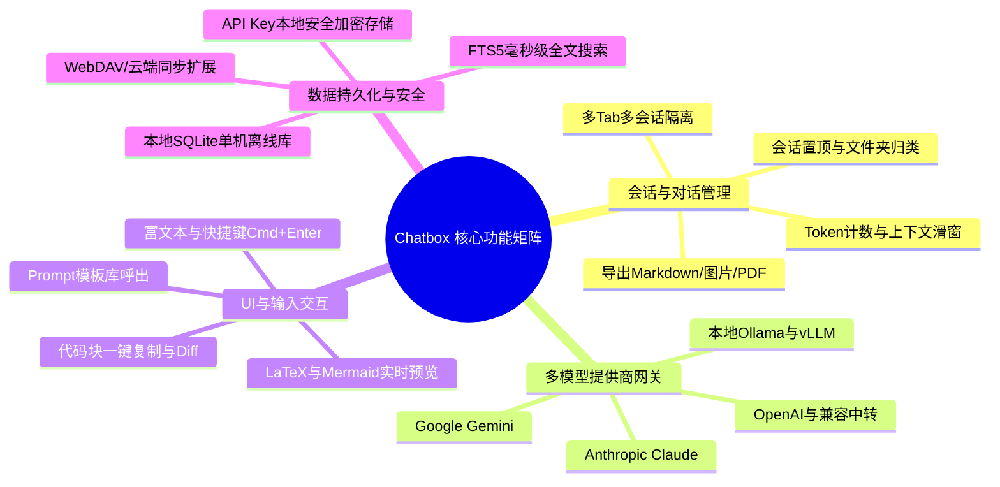
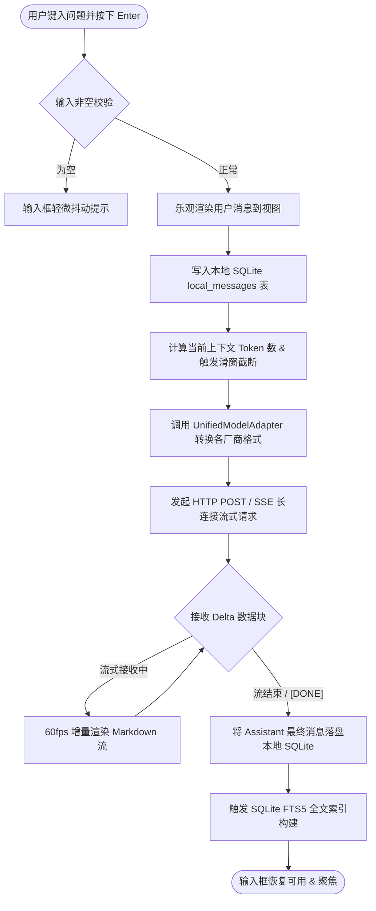
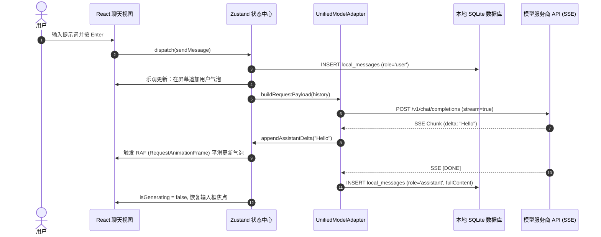
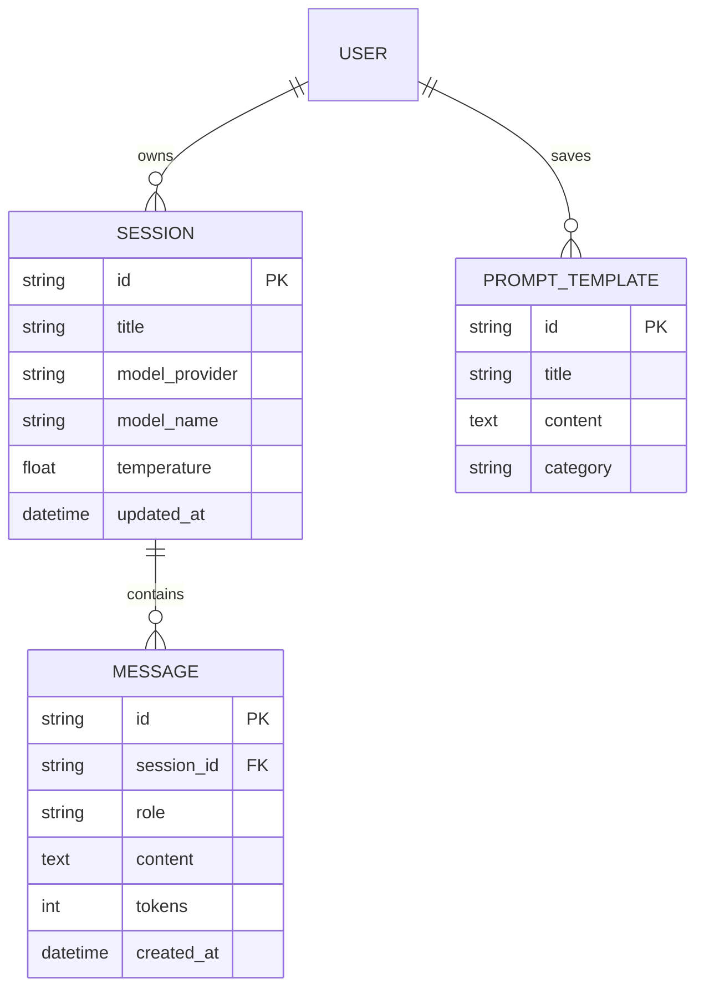

# Chatbox 开源 AI 客户端 1:1 落地复刻规格书 (Fullstack Replication Blueprint)

> **分析对象**：[Chatbox](https://github.com/Bin-Huang/chatbox) (全球 25K+ Stars 顶尖开源 AI 桌面/跨平台客户端)  
> **底层架构**：React 18/19 + Electron / Tauri + SQLite (本地持久化) + 统一多模型协议网关  
> **开源协议**：GPL-3.0 / MIT 兼容规范  
> **复刻标准**：视觉 1:1 像素级还原 / 控件级事件与响应链路完全闭环 / 编译级 OpenAPI 契约 / 生产与本地双 SQL DDL  
> **文档版本**：v2.0.0 (Official Open-Source Showcase Blueprint)  

---

## 1. 系统业务定位与功能全貌 (Executive Blueprint)

### 1.1 产品核心定位与商业价值
Chatbox 是一款面向开发者的**开箱即用、多模型聚合桌面客户端**。
- **解决核心痛点**：
  1. **数据隐私安全**：所有 Prompt、API Key 与会话历史 100% 存储于本地 SQLite，无第三方中间服务器嗅探；
  2. **模型自由切换**：统一抽象支持 OpenAI、Claude、Gemini、Ollama、Groq、DeepSeek 等 10+ 主流厂商，随时无缝热切换；
  3. **丰富开发工具集成**：支持 Markdown 60fps 流式排版、代码高亮复制、Mermaid 图表即时渲染、LaTeX 公式预览及 Prompt 模板库。
- **核心用户角色**：
  - 研发工程师、数据分析师、AI 提示词工程师、个人重度知识工作者。

### 1.2 系统功能矩阵拓扑图 (Feature Hierarchy)


### 1.3 核心业务主流程图 (Core Business Flowchart)


---

## 2. 视觉系统与 UI/UX 交互闭环 (Visuals & Interaction System)

### 2.1 界面原画图谱与布局规范
* **主工作区布局**：标准三栏式 / 两栏自适应布局：
  - **左侧边栏 (240px 固定宽度)**：包含“新对话”主按钮、历史会话列表（按时间分组：今天、前7天、更早）、搜索栏、底部设置入口；
  - **中央主聊天区 (Flex 自动拉伸)**：顶部会话标题与模型切换下拉菜单、中央流式滚动消息流、底部吸顶输入工具条。
* **主题系统**：完美支持 Light（清新浅灰 `#F8FAFC`）与 Dark（深邃极客 `#0F172A`）自动跟随系统切换。

### 2.2 像素级 Design Tokens 规范 (Design System Tokens)
* **色彩矩阵 (Color Palette - Dark Mode)**：
  - 背景底色：`bg-main: #0F172A`
  - 侧边栏色：`bg-sidebar: #1E293B`
  - 卡片/气泡底色：`bg-card: #334155`（用户气泡）、`bg-assistant: #1E293B`（模型气泡）
  - 品牌重音色：`accent-primary: #3B82F6` (Hover: `#2563EB`)
  - 边框线色：`border: #334155`
* **Tailwind 配置代码 (`tailwind.config.js`)**：
  ```javascript
  module.exports = {
    darkMode: 'class',
    theme: {
      extend: {
        colors: {
          background: '#0F172A',
          surface: '#1E293B',
          bubble: '#334155',
          primary: '#3B82F6',
        },
        borderRadius: {
          bubble: '12px',
        }
      }
    }
  };
  ```

### 2.3 控件级【按键-动作-响应】全局映射矩阵 (Event-to-Action Matrix)

| 控件名称 / 视觉位置 | 触发事件 | 本地状态变更 (State Mutation) | 触发的本地/网络调用 | 渲染结果与 4 态表现 |
| :--- | :--- | :--- | :--- | :--- |
| **“新建对话”按钮** (侧边栏顶部) | `onClick` | 清空当前会话激活态，`activeSessionId = newId` | SQLite `INSERT INTO local_sessions` | 左侧列表首行插入新会话并高亮，右侧清空展示“向 AI 提问”空状态插画 |
| **消息发送按钮** (输入框右下角) | `onClick / Enter` | `isGenerating: true`，输入框置为禁用 | 调用 Adapter 发起 `POST /chat/completions` (SSE) | 发送按钮变为方块“停止生成”图标，消息流底部实时滚动呈现打字机动效 |
| **“停止生成”按钮** (生成中出现) | `onClick` | `isGenerating: false` | 触发 `AbortController.abort()` 断开 SSE 连接 | 立即终止流式推流，保留已生成的文本内容并落库本地 SQLite |
| **模型切换选择器** (聊天区顶部) | `onChange` | 更新当前 Session 的 `model_name` | SQLite `UPDATE local_sessions SET model_name = ?` | 下拉菜单收起，顶部徽标变为新模型名称，次条请求将指向新模型路由 |
| **代码块“复制”图标** (代码块右上角) | `onClick` | 内部临时状态 `isCopied: true` | `navigator.clipboard.writeText(code)` | 图标从双矩形变为绿色对勾（Check），2 秒后自动恢复原样 |

### 2.4 关键交互时序图 (Interaction Sequence)


---

## 3. 前端工程与组件架构 (Frontend Architecture)

### 3.1 架构分层
- **视图层 (View Layer)**：React 18/19 + Tailwind CSS + Lucide React 图标库；
- **状态管理 (Store Layer)**：Zustand / MobX，分离 `sessionStore`、`settingsStore`、`uiStore`；
- **Markdown 排版系统**：`react-markdown` + `remark-gfm` + `remark-math` + `rehype-katex` + `rehype-prism-plus`；
- **桌面包装外壳 (Runtime Shell)**：Electron 32+ 或 Tauri 2.0 (Rust)，通过 IPC 通信安全调用本地 SQLite。

---

## 4. 后端架构与接口协议 (Backend Architecture & APIs)

### 4.1 接口契约
完整遵循标准 **OpenAPI 3.0.3** 规范，详见配套文件：
- 契约文件位置：[`contracts/chatbox_api.yaml`](contracts/chatbox_api.yaml)
- 涵盖统一 Chat Completion、可用模型查询与跨端会话同步 REST 接口。

### 4.2 全局错误码字典
| 业务错误码 | HTTP Status | 触发原因 | 前端推荐处理方式 |
| :--- | :--- | :--- | :--- |
| `INVALID_API_KEY` | 401 | 填写的 API 密钥无效 | 气泡标红提示，并弹出快捷入口按钮“去设置中配置 API Key” |
| `RATE_LIMIT_EXCEEDED` | 429 | 服务商调用频率触达限制 | 展示冷却倒计时，并提示用户切换备用模型或提供重试按钮 |
| `NETWORK_TIMEOUT` | 504 / TypeError | 本地网络连接超时或代理断开 | 气泡下方展示“网络连接异常，点击重新生成”，保留已键入内容 |

---

## 5. 数据实体模型与持久化层 (Data Models & Persistence)

### 5.1 实体关系模型 (Entity-Relationship Diagram)


### 5.2 生产级 DDL 脚本交付
- **云端多端同步 (PostgreSQL)**：详见配套文件 [`schemas/ddl.sql`](schemas/ddl.sql)
- **本地单机存储 (SQLite + FTS5 全文索引)**：详见配套文件 [`schemas/sqlite_client_schema.sql`](schemas/sqlite_client_schema.sql)

---

## 6. 核心算法与硬核模块解密 (Core Algorithms)

### 6.1 统一多模型 Adapter 转换伪代码
```typescript
interface UnifiedChatRequest {
  model: string;
  messages: Array<{ role: string; content: string }>;
  stream: boolean;
}

export class UnifiedModelAdapter {
  static transformPayload(provider: 'openai' | 'claude' | 'gemini', req: UnifiedChatRequest) {
    switch (provider) {
      case 'openai':
        return { ...req }; // 原生兼容
      case 'claude':
        return {
          model: req.model,
          max_tokens: 4096,
          system: req.messages.find(m => m.role === 'system')?.content,
          messages: req.messages.filter(m => m.role !== 'system')
        };
      case 'gemini':
        return {
          contents: req.messages.map(m => ({
            role: m.role === 'assistant' ? 'model' : 'user',
            parts: [{ text: m.content }]
          }))
        };
    }
  }
}
```

### 6.2 上下文滑窗 Token 截断算法
```python
def truncate_context_messages(messages: list, max_window: int = 8192, reserve_tokens: int = 1000) -> list:
    """
    基于 Token 计数的最近对话滑动窗口裁剪算法
    确保总请求不会超出模型上下文限制，且强制保留 System Prompt
    """
    system_msg = [m for m in messages if m['role'] == 'system']
    chat_history = [m for m in messages if m['role'] != 'system']
    
    budget = max_window - reserve_tokens
    selected = []
    
    # 从最新的消息倒序累加
    for msg in reversed(chat_history):
        msg_token = len(msg['content']) // 3  # 快速估算或 tiktoken
        if budget - msg_token < 0:
            break
        budget -= msg_token
        selected.append(msg)
        
    return system_msg + list(reversed(selected))
```

---

## 7. 1:1 落地复刻实施路线图 (Reconstruction Roadmap)

### 7.1 Monorepo 脚手架目录规划
```plaintext
├── apps/
│   └── desktop/           # Electron / Tauri 桌面客户端入口
├── packages/
│   ├── core/              # 多模型 Adapter、Token 算法、SQLite 数据操作
│   ├── ui/                # Tailwind 组件库 (Sidebar, ChatList, MarkdownViewer)
│   └── contracts/         # OpenAPI 生成的前后端类型定义
├── mock/                  # 本地极速联调配置 (Prism Mock)
└── package.json
```

### 7.2 本地极速 Mock 联调
- 前端团队执行 `prism mock contracts/chatbox_api.yaml -p 4010`，即可无需任何 API Key，在本地独立调通所有新建会话与对话渲染交互（详见 [`mock/README.md`](mock/README.md)）。

### 7.3 分阶段 Sprint 落地排期
- **Sprint 1 (骨架与本地数据库)**：搭建 Tauri/Electron 基础外壳，跑通 SQLite 表迁移与本地配置读写。
- **Sprint 2 (UI 像素级还原与 Mock 联调)**：还原 Dark/Light 主题、侧边栏、消息气泡，对接 Prism Mock 跑通全交互。
- **Sprint 3 (多模型适配与流式推流)**：实现 OpenAI/Claude/Ollama 的 UnifiedModelAdapter 与 SSE 流式增量渲染。
- **Sprint 4 (FTS5 全文检索与打包发布)**：实现消息秒级全文搜索、多平台安装包构建（Windows .exe / Mac .dmg）。
