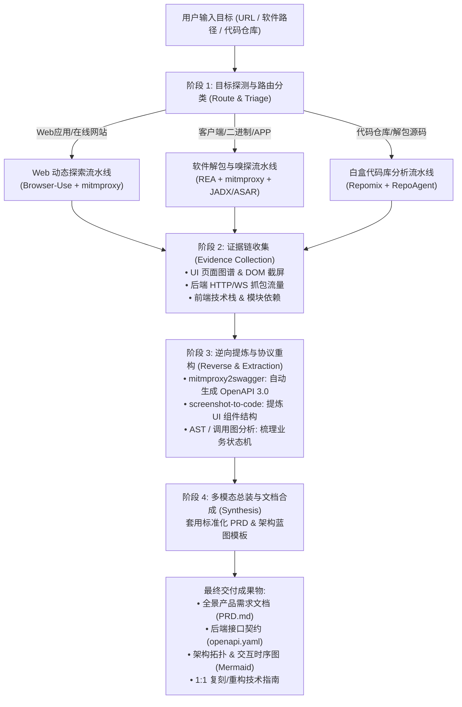

# App Reverse Spec (全栈应用逆向与全景方案生成工作流)

当用户提供一个**软件名称/可执行文件、网站URL、APP安装包或代码仓库**，并要求分析其 UI、前端、后端、交互、功能并输出完整方案时，激活本技能。

---

## 一、核心工作流概览

本技能将逆向与方案输出抽象为 **5 步标准化流水线 (5-Phase Pipeline)**：



---

## 二、目标分类与路由规则 (Target Routing)

当接收到用户目标时，首先判定目标类型并执行相应工具链路：

| 目标类型 | 识别特征 | 核心开源工具链 | 关键动作 |
| :--- | :--- | :--- | :--- |
| **类型 A：在线网站 / Web应用** | HTTP/HTTPS 链接、SaaS平台 | `browser-use` + `mitmproxy2swagger` + `Wappalyzer` | 启动浏览器无头/有头爬虫遍历各子路由；开启代理抓包生成 OpenAPI；提取前端依赖 |
| **类型 B：桌面/移动客户端** | `.exe`, `.asar`, `.apk`, `.dmg`, 软件安装目录 | `REA` + `mitmproxy` + `apktool/jadx` + `screenshot-to-code` | 静态解包资源与配置；挂载系统证书截获客户端网络调用；多模态截屏提取 UI 交互组件 |
| **类型 C：开源/解包代码库** | GitHub URL、本地源码目录、解包源码 | `repomix` / `gitingest` + `RepoAgent` | 仓库级上下文打包；提取 Router、Controller、ORM Model；生成依赖图与数据流图 |

---

## 三、各阶段详细操作指南

### 阶段 1：目标探测与环境初始化
1. **分析输入形态**：
   - 如果是 URL：检查是否需登录鉴权、是否存在反爬、是否为单页面应用 (SPA)。
   - 如果是本地文件：使用 `file` / PE头探测是 Electron、Flutter、Qt、C# 还是原生二进制。
2. **准备临时工作区**：在当前工作空间建立 `.analysis/<target_name>/`，用于存放网络抓包、截屏和生成的临时文件。

### 阶段 2：动态交互与后端流量捕获
1. **网络流量监听**：
   - 运行代理脚本或监听 HAR 导出：
     ```bash
     mitmproxy -w .analysis/<target_name>/traffic.flow --mode regular@8080
     ```
   - 或者使用浏览器开发者工具/Playwright 直接导出 `.har` 文件到 `.analysis/<target_name>/traffic.har`。
2. **UI 遍历与行为录制**：
   - 运行 `Browser-Use` 智能体或执行自动化脚本遍历主要导航菜单、表单提交、弹窗等交互。
   - 自动截取关键页面截图保存到 `.analysis/<target_name>/screenshots/`。

### 阶段 3：数据反向解析与标准化
1. **自动生成 OpenAPI (Swagger) 规格**：
   - 针对抓包数据执行 `mitmproxy2swagger`：
     ```bash
     mitmproxy2swagger -i .analysis/<target_name>/traffic.har -o .analysis/<target_name>/openapi.yaml -p <api_base_prefix>
     mitmproxy2swagger -i .analysis/<target_name>/traffic.har -o .analysis/<target_name>/openapi.yaml -p <api_base_prefix> --generate-summaries
     ```
   - 产出标准的 `openapi.yaml` 包含了所有捕获到的端点、入参字段、Query 参数、JSON 响应 Schema 及鉴权 Header。
2. **前端与 UI 组件抽象**：
   - 对核心截图应用视觉多模态分析，提取：
     - 色彩体系、排版层级、核心控件库（Form, Modal, Table, Chart）。
     - 交互触发点（Hover, Click, Drag, Infinite Scroll）。

### 阶段 4：白盒补充分析（如可用）
- 若存在 JS bundle / Electron asar / 源码：
  - 运行 `repomix --include "src/**,routes/**,models/**"` 提取骨干代码。
  - 提取数据持久化层定义（Prisma schema, SQLAlchemy, Mongoose models, SQL DDL）。

### 阶段 5：全景方案与 PRD 产出
将上述收集到的所有结构化线索合成，严格按照 [`references/PRD_TEMPLATE.md`](references/PRD_TEMPLATE.md) 产出企业级文档。

---

## 四、执行输出要求（文档标准）

每次针对目标软件输出的方案必须**包含以下六大章节**：
1. **产品全貌与业务拓扑**：业务核心价值、功能矩阵脑图、核心业务逻辑流（Mermaid Flowchart）。
2. **UI/UX 交互与用户旅程**：页面路由清单、核心交互时序图（Mermaid Sequence）、组件清单与状态说明。
3. **前端技术架构**：前端框架/状态管理/网络请求/样式方案、代码解构与工程目录规划。
4. **后端架构与接口契约**：逆向出的 REST/WebSocket 接口清单、鉴权认证流程、OpenAPI 核心端点及请求响应示例。
5. **数据实体模型与状态机**：核心业务实体关系图（Mermaid ER Diagram）、核心对象生命周期状态机。
6. **1:1 落地复刻与重构方案**：推荐技术选型（现代化替代方案）、实施阶段路线图、难点攻坚点（如高并发、复杂算法、反爬绕过）。

---

## 五、参考资料与辅助脚本

- 核心工具链配置手册：[`references/TOOLCHAIN.md`](references/TOOLCHAIN.md)
- 产出方案标准模板：[`references/PRD_TEMPLATE.md`](references/PRD_TEMPLATE.md)
- 快速探测与抓包辅助脚本：[`scripts/run_analyzer.py`](scripts/run_analyzer.py)
