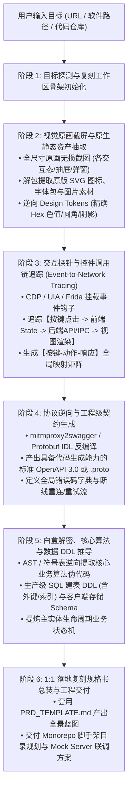

# App Reverse Spec (全栈应用 1:1 落地复刻与全景规格书工作流)

当用户提供一个**软件名称/可执行文件、网站URL、APP安装包或代码仓库**，并要求分析其 UI、前端、后端、交互、功能并输出**达到“可直接通过文档复刻软件”**的标准方案时，激活本技能。

---

## 一、核心工作流概览 (6-Phase Replication Pipeline)



---

## 二、目标分类与路由规则 (Target Routing)

| 目标类型 | 识别特征 | 核心开源工具链 | 关键复刻动作 |
| :--- | :--- | :--- | :--- |
| **类型 A：在线网站 / Web应用** | HTTP/HTTPS 链接、SaaS平台 | `Playwright` + `mitmproxy2swagger` + `CDP Event Listener` | 自动化遍历子路由并高清截屏；导出 HAR 逆向 OpenAPI；监听 DOM 事件提取按键触发函数 |
| **类型 B：桌面客户端 (Electron/CEF)** | `.exe`, `.asar`, 包含 `d3dcompiler` 等文件 | `asar` 解包 + `--remote-debugging-port` + `mitmproxy` | 解包提取原版 SVG/PNG 资产；DevTools 注入获取 Vue/React 状态与组件树；抓包逆向 API |
| **类型 C：原生客户端 (Win32/WPF/Qt)** | 原生 `.exe`, `.dll`, PE 文件 | `UIAutomation` (pywinauto) + `Frida` + `Inspect` + PE 资源提取 | 遍历 UIA 控件树；Hook 网络 Socket 关联按钮点击；抽取 PE `.rsrc` 图标资源 |
| **类型 D：移动客户端 (Android APK)** | `.apk`, `.aab` | `apktool` + `jadx` + `Frida` + `mitmproxy` | 解压提取 drawable 矢量图；反编译 Smali/Java 提取 API 与加密算法；抓包提取 JSON |
| **类型 E：开源/解包代码库** | GitHub URL、本地源码目录 | `Repomix` + `Tree-sitter` + `RepoAgent` | 仓库级上下文打包；提取 Router、Controller、ORM Model；生成依赖图与数据流图 |

---

## 三、各阶段详细操作指南

### 阶段 1：目标探测与复刻工作区骨架初始化
1. **分析输入形态**：判断是 Web 还是 Electron、WPF、Qt、PE 原生。
2. **初始化复刻工程目录**：在当前工作空间建立标准的分析与资产目录：
   ```plaintext
   .analysis/<target_name>/
   ├── screenshots/       # 存放高保真原画截屏
   ├── assets/            # 存放解包抽取的原版 SVG、图片、字体
   ├── contracts/         # 存放 openapi.yaml 或 .proto 契约文件
   ├── schemas/           # 存放 sql_ddl.sql 或 prisma.schema
   └── traffic/           # 存放 traffic.har / traffic.flow
   ```

### 阶段 2：视觉原画截屏与原生静态资产抽取
1. **高清全尺寸截屏**：
   - 绝不允许“无图脑补”，必须保存目标软件的核心界面原画截屏到 `screenshots/`；
   - 覆盖正常工作台、展开抽屉、操作弹窗、空状态、骨架屏与报错状态。
2. **原始素材 100% 抽取**：
   - 若为 Electron：运行 `npx asar extract <app.asar> extracted/`，拷贝其中的 `svg/`, `icons/`, `images/`, `fonts/` 到 `assets/`；
   - 若为原生程序：提取 PE 图标与资源。
3. **样式 Token 逆向**：
   - 提取精确的 HEX 色值（主色、容器背景、边框）、字体族、圆角半径、阴影效果，生成 `tailwind.config.js` 配置。

### 阶段 3：交互探针与控件调用链追踪 (Event-to-Network Tracing)
1. **识别每个按键的前因后果**：
   - 挂载事件探针（CDP `getEventListeners` 或 UIA 控件树）；
   - 点击控件 $\to$ 记录前端本地 State 变化 $\to$ 抓取伴随的网络 API 请求 $\to$ 观察响应后的 UI 变化。
2. **产出【按键-动作-响应】全局映射矩阵**：
   - 详细记录控件标识、触发事件、前置校验、接口端点与成功/失败视图表现。

### 阶段 4：协议逆向与工程级契约生成
1. **生成具备代码生成能力的契约**：
   - 针对抓包数据执行 `mitmproxy2swagger -i traffic.har -o contracts/openapi.yaml -p <prefix> --generate-summaries`；
   - 针对 gRPC/Connect-RPC 导出或整理对应的 `.proto` 文件。
2. **补全协议鲁棒性**：
   - 明确 Header 鉴权、签名算法、状态码矩阵与 SSE/WebSocket 断线重连机制。

### 阶段 5：白盒解密、核心算法与数据 DDL 推导
1. **数据库 DDL 逆向**：
   - 根据接口返回的 JSON Schema 与本地数据库（如 SQLite `state.vscdb`），编写生产级可执行的 `CREATE TABLE` 脚本与索引。
2. **核心业务算法伪代码化**：
   - 对核心算法（如 Diff 对齐、哈希同步、推测解码缓存）编写清晰的执行伪代码。

### 阶段 6：高保真落地复刻规格书总装
1. 将上述成果严格按照 [`references/PRD_TEMPLATE.md`](references/PRD_TEMPLATE.md) 组装为包含 7 大核心章节的全栈规格书。
2. 给出 Monorepo 脚手架规划与基于 OpenAPI 的一键 Mock Server 联调方案。

---

## 四、执行输出要求（7 大核心章节标准）

每次针对目标软件输出的方案必须**包含以下七大章节**：
1. **系统业务定位与功能全貌**：核心商业模式、功能矩阵脑图、核心业务逻辑流。
2. **视觉系统与 UI/UX 交互闭环**：真实截图索引、Design Tokens 规范、**【按键-动作-响应】全局映射矩阵**、交互时序图。
3. **前端工程与组件架构**：技术栈选型、组件树拆解、客户端状态流与缓存策略。
4. **后端架构与接口协议**：网络拓扑、**可执行级 OpenAPI 3.0 / Protobuf IDL 契约**、全局错误码与重试机制。
5. **数据实体模型与持久化层**：Mermaid ER 图、**生产级可执行建表 DDL (SQL)**、客户端本地存储 Schema。
6. **核心算法与硬核模块解密**：核心算法伪代码、原生算力层 (N-API/C++) 接口定义。
7. **1:1 落地复刻与实施路线图**：Monorepo 脚手架目录、本地 Mock Server 极速联调指南、Sprint 排期与验收准则 (DoD)。

---

## 五、参考资料与辅助脚本

- 核心工具链配置手册：[`references/TOOLCHAIN.md`](references/TOOLCHAIN.md)
- 产出方案标准模板：[`references/PRD_TEMPLATE.md`](references/PRD_TEMPLATE.md)
- 自动化探测与复刻脚手架脚本：[`scripts/run_analyzer.py`](scripts/run_analyzer.py)
