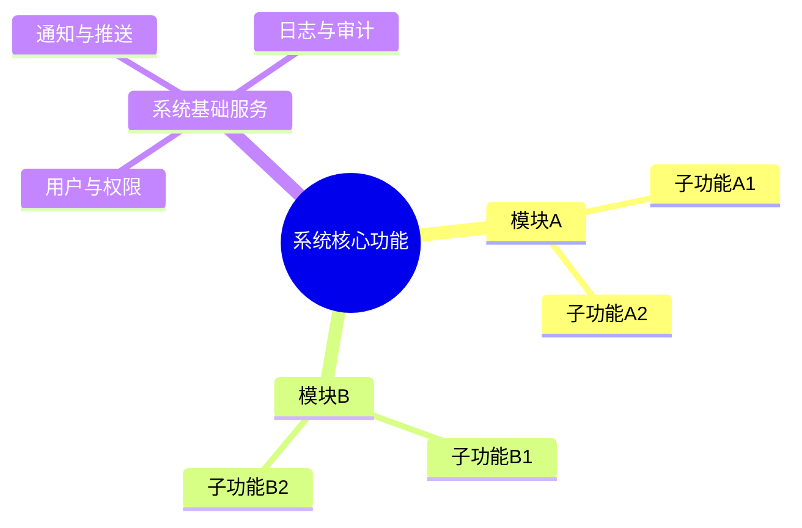
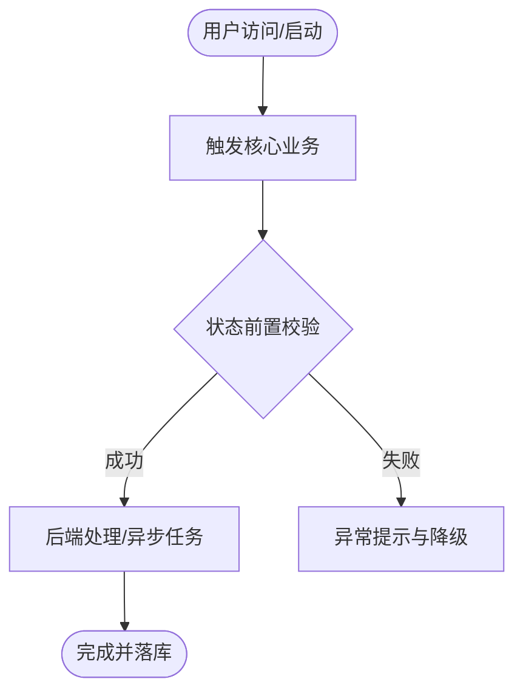
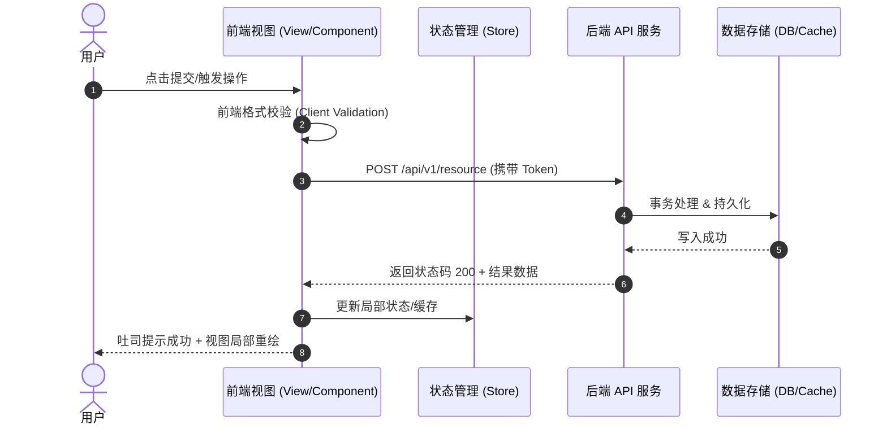
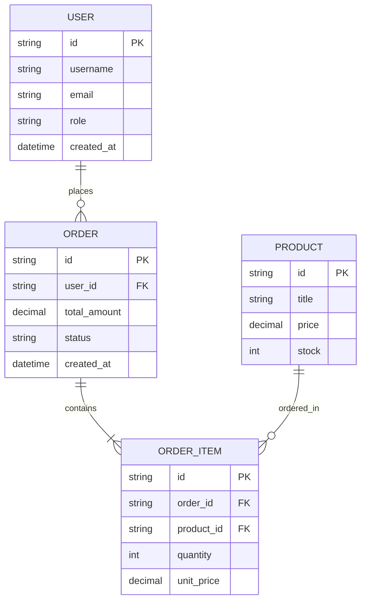
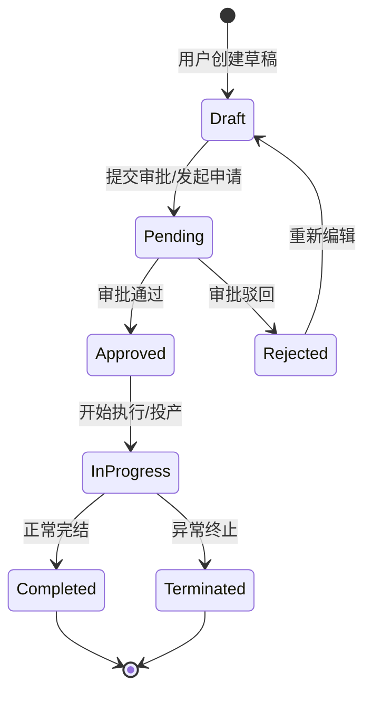

# 全景逆向产品需求与架构规格书模板 (Fullstack PRD & Blueprint Template)

本模板是 `app-reverse-spec` 技能最终生成完整方案的标准结构规范。分析任何软件或网站时，必须严格按照以下章节展开输出：

---

# [目标系统名称] 全栈逆向分析与全景技术重构方案

> **分析对象**：[目标名称/URL/安装包名称]  
> **分析维度**：UI 视觉规范 / 前端架构 / 交互流 / 后端 API / 数据模型 / 核心业务逻辑  
> **文档版本**：v1.0.0 (Reverse Spec Blueprint)  

---

## 1. 系统业务定位与功能全貌 (Executive Blueprint)

### 1.1 产品核心定位与目标用户
- 解决的核心痛点：
- 核心商业/业务场景：
- 关键用户角色：

### 1.2 功能矩阵树 (Feature Hierarchy)


### 1.3 核心业务主流程图 (Core Business Flowchart)


---

## 2. UI/UX 交互与用户旅程 (User Interface & Interaction)

### 2.1 页面路由与信息架构 (Information Architecture)
| 页面/视窗名称 | 路由路径 / 窗口标识 | 核心功能与呈现信息 | 权限级别 |
| :--- | :--- | :--- | :--- |
| 仪表盘 / 首页 | `/dashboard` | 数据总览、快捷入口、统计指标 | 登录用户 |
| 详情/编辑页 | `/items/:id` | 详细信息展现、表单编辑、操作按钮组 | 操作员/管理员 |

### 2.2 关键交互时序图 (Interaction Sequence)
展示用户在界面上的操作与前端组件、后端 API 之间的数据时序：


### 2.3 UI 组件规范与设计系统 (Design System)
- **配色规范**：主品牌色、中性色、功能色（成功/警告/危险）。
- **核心组件拆解**：
  - 导航区（Header / Sidebar）
  - 数据展示区（Table / Card Grid / Virtual List）
  - 反馈与操作（Modal / Drawer / Tooltip / Toast）

---

## 3. 前端工程与技术架构 (Frontend Architecture)

### 3.1 技术栈判定与选型推荐
- **原系统技术特征**：[检测出的框架：如 React / Vue / Next.js / Electron / Flutter]
- **现代化重构推荐**：[如 Next.js 14 + Tailwind CSS + Zustand + shadcn/ui]

### 3.2 客户端状态管理与数据缓存流
- 本地持久化：LocalStorage / IndexedDB / SQLite (客户端)
- 异步请求缓存：TanStack Query (React Query) / SWR 机制
- 实时推送协议：WebSocket / Server-Sent Events (SSE) 交互设计

---

## 4. 后端架构与接口协议 (Backend Architecture & APIs)

### 4.1 认证与鉴权机制 (Auth & Security)
- **鉴权类型**：Bearer JWT / OAuth2 / Session Cookie / API Key
- **Token 刷新流程**：双 Token 轮转机制（Access Token + Refresh Token）
- **请求签名/防刷**：是否存在时间戳签名 (Sign) 或 WAF 校验。

### 4.2 核心 REST / RPC 接口规范 (基于 mitmproxy2swagger 提炼)

#### 接口 1：[功能名称，如：获取资源列表]
- **Endpoint**: `GET /api/v1/resources`
- **Request Headers**:
  ```http
  Authorization: Bearer <token>
  Content-Type: application/json
  ```
- **Query Parameters**:
  - `page`: 整数 (当前页数，默认 1)
  - `limit`: 整数 (每页条数，默认 20)
  - `status`: 字符串 (状态过滤)
- **Response (200 OK)**:
  ```json
  {
    "code": 0,
    "message": "success",
    "data": {
      "total": 100,
      "items": [
        {
          "id": "res_123",
          "name": "示例项目",
          "status": "active",
          "created_at": "2026-10-11T12:00:00Z"
        }
      ]
    }
  }
  ```

#### 接口 2：[写操作/核心业务提交]
- **Endpoint**: `POST /api/v1/resources`
- **Request Body**:
  ```json
  {
    "name": "新资源名称",
    "category_id": 102,
    "attributes": {
      "theme": "dark"
    }
  }
  ```
- **Response (201 Created)**:
  ```json
  {
    "code": 0,
    "data": {
      "id": "res_124"
    }
  }
  ```

---

## 5. 数据实体模型与状态机 (Data Models & State Machine)

### 5.1 实体关系模型 (Entity-Relationship Diagram)


### 5.2 核心对象生命周期状态机 (Business State Machine)


---

## 6. 1:1 落地复刻与重构实施方案 (Reconstruction Roadmap)

### 6.1 推荐现代化技术选型清单
| 层次 | 推荐选型 | 理由与收益 |
| :--- | :--- | :--- |
| **前端框架** | Next.js 15 / Vite + React 19 | SSR/SSG 支持，现代组件生态丰富 |
| **UI 库** | Tailwind CSS + shadcn/ui | 1:1 高度定制 UI 样式，无沉重样式锁死 |
| **后端语言** | Go (Gin / Fiber) 或 TypeScript (NestJS) | 高并发性能优秀，强类型保障业务规范 |
| **数据持久化** | PostgreSQL + Prisma / GORM | 完备的关系型事务支持与 JSON 查询 |
| **缓存/消息** | Redis + RabbitMQ / Kafka | 削峰填谷，高性能状态会话存储 |

### 6.2 分阶段实施路线图 (Sprint Plan)
- **Sprint 1 (基础骨架与鉴权)**：前后端脚手架搭建、数据库表结构迁移 (DDL)、用户登录/注册鉴权闭环。
- **Sprint 2 (核心功能与 UI 还原)**：UI 高保真还原、核心列表/编辑/表单交互实现、对接后端 REST 接口。
- **Sprint 3 (复杂业务逻辑与状态闭环)**：状态流转机、审批流/异步任务处理、WebSocket 实时推送通知。
- **Sprint 4 (性能调优与部署上线)**：全链路压测、缓存预热、Docker/K8s 容器化编排、CI/CD 自动化流水线。

### 6.3 关键技术攻坚点与风险应对
1. **反爬与安全攻防**：针对高频请求进行限流与 Token 校验。
2. **状态同步一致性**：高并发场景下的乐观锁/分布式锁机制。
3. **数据迁移方案**：如何无缝平滑割接老系统数据。
