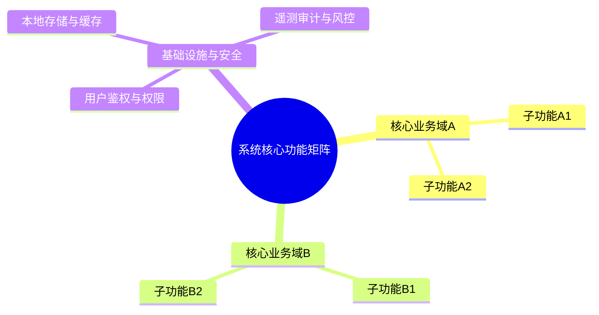
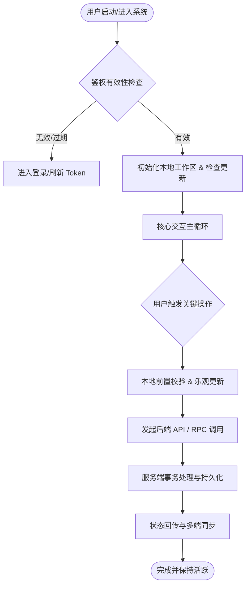
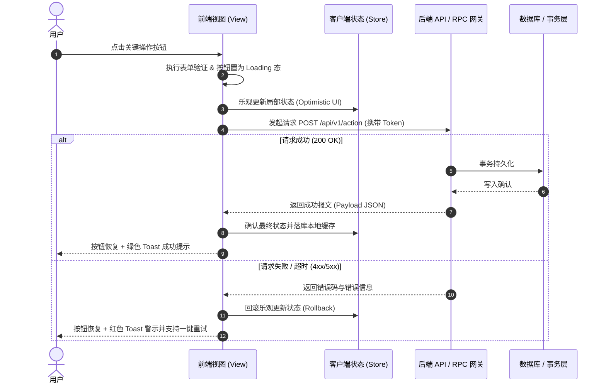
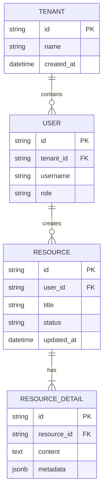

# 全栈应用 1:1 落地复刻规格书与架构白皮书模板 (1:1 Replication Blueprint Template)

本模板是 `app-reverse-spec` 技能生成**工业级、可直接交付工程师团队复刻软件**的标准输出规范。分析任何软件、网站或客户端时，必须严格按照以下章节展开输出，杜绝任何需开发人员“脑补”的模糊描述。

---

# [目标系统名称] 全栈逆向工程与 1:1 落地复刻规格书

> **分析对象**：[目标系统名称 / 版本号 / 安装包路径 / 目标URL]  
> **底层架构**：[如 Electron + React 19 / Qt 6 + C++ / Next.js 15 / 原生 Win32 + Rust]  
> **复刻标准**：视觉 1:1 像素级还原 / 控件级事件与响应链路完全闭环 / 协议级代码生成契约 / 数据可执行 DDL  
> **文档版本**：v2.0.0 (Executable Production Blueprint)  

---

## 1. 系统业务定位与功能全貌 (Executive Blueprint)

### 1.1 产品核心定位与商业价值
- **核心业务场景与痛点**：
- **商业化模式与收费边界**：
- **目标用户角色与使用旅程**：

### 1.2 系统功能矩阵拓扑图 (Feature Hierarchy)


### 1.3 核心业务主流程图 (Core Business Flowchart)


---

## 2. 视觉系统与 UI/UX 交互闭环 (Visuals & Interaction System)

### 2.1 真实界面原画图谱与截图索引 (Visual Screenshots Index)
> **硬性要求**：必须在工作区生成并引用真实原画截屏，标注每个关键视窗、抽屉、弹窗的视觉基线。

| 页面/视窗名称 | 路由/入口标识 | 高清原画截图引用 | 核心布局结构与呈现信息 |
| :--- | :--- | :--- | :--- |
| **主工作台 / 仪表盘** | `/dashboard` 或 主窗口 | `` | 左右分栏、顶部导航、核心工作区 |
| **核心编辑/操作浮层** | 快捷键或操作触发 | `` | 居中悬浮、毛玻璃背景、输入与反馈组件 |
| **设置与配置面板** | 偏好设置入口 | `` | 左侧分类导航、右侧表单与开关列表 |

### 2.2 像素级 Design Tokens 规范 (Design System Tokens)
* **色彩矩阵 (Color Palette)**：
  - 背景主色：`bg-primary: #121214`
  - 侧边栏/容器色：`bg-secondary: #18181b`
  - 边框与分割线：`border: #27272a`
  - 品牌主重音色：`accent: #7c3aed` (Hover: `#6d28d9`, Active: `#5b21b6`)
  - 状态功能色：成功 `#22c55e`、警告 `#f59e0b`、危险 `#ef4444`、提示 `#3b82f6`
* **排版与间距 (Typography & Spacing)**：
  - 字体族：`font-sans: 'Inter', system-ui, -apple-system, sans-serif`
  - 代码字体：`font-mono: 'JetBrains Mono', monospace`
  - 边角圆角：基础控件 `rounded-md: 6px`、悬浮窗口 `rounded-xl: 12px`
  - 阴影系统：`shadow-floating: 0 10px 30px -10px rgba(0, 0, 0, 0.5)`
* **Tailwind 配置代码片段 (`tailwind.config.js`)**：
  ```javascript
  module.exports = {
    theme: {
      extend: {
        colors: {
          background: '#121214',
          surface: '#18181b',
          border: '#27272a',
          primary: '#7c3aed',
        },
        borderRadius: {
          DEFAULT: '6px',
          modal: '12px',
        }
      }
    }
  };
  ```

### 2.3 控件级【按键-动作-响应】全局映射矩阵 (Event-to-Action Matrix)
> **硬性要求**：逐一列出界面每个关键按钮/交互项的触发链路，杜绝任何需开发人员猜测的行为。

| 控件名称 / 视觉位置 | 触发事件 | 本地状态变更 (State Mutation) | 触发的后端接口 / 本地IPC | 成功/失败后的 UI 渲染结果 |
| :--- | :--- | :--- | :--- | :--- |
| **“新建/创建”按钮** (右上角) | `onClick` | `isCreating: true`, 开启 Modal | `POST /api/v1/items` | 成功：关闭 Modal、追加到列表首项、弹出 Toast；失败：表单内标红提示报错信息 |
| **“删除”图标** (表格操作列) | `onClick` | `deleteTargetId: item.id` | 无 (本地先弹二次确认窗) | 弹出高危警示确认弹窗，确定后触发 `DELETE /api/v1/items/{id}`，成功后表格行执行淡出动画 |
| **快捷键 `Ctrl+K`** | `onKeyDown` | `isFloatingBarOpen: true` | 本地缓存快速检索 | 屏幕正中微动画弹出浮层胶囊，主输入框自动获取焦点 (autofocus) |

### 2.4 关键交互时序图 (Interaction Sequence)


---

## 3. 前端工程与组件架构 (Frontend Architecture)

### 3.1 技术栈解密与重构选型
- **原系统技术特征**：[检测出的框架：如 React 19 / Electron 34 / Vue 3 / Qt 6]
- **1:1 复刻推荐选型**：[如 Next.js 15 / Vite + React 19 + Zustand + Radix UI / shadcn]
- **性能优化手段**：虚拟列表 (Virtual Scroll)、Web Workers 数据解析、流式渲染 (Streaming SSR)

### 3.2 客户端状态管理与缓存模型
- **全局状态流转**：Zustand / Redux Toolkit 状态切片规划
- **异步数据请求与缓存**：TanStack Query (React Query) 缓存淘汰与乐观重试机制
- **长连接与实时同步**：WebSocket / SSE 心跳保活与断线重连（Exponential Backoff）

---

## 4. 后端架构与接口协议 (Backend Architecture & APIs)

### 4.1 网络拓扑与安全认证
- **网关与域名拓扑**：主接口、长连接推送、文件上传、遥测上报地址清单
- **鉴权机制**：Bearer JWT 签名、双 Token 刷新（Access Token + Refresh Token 轮转机制）
- **通信请求头规范 (Headers)**：
  ```http
  Authorization: Bearer <token>
  Content-Type: application/json
  x-client-version: 1.0.0
  x-request-id: <uuid>
  ```

### 4.2 工程级接口契约 (OpenAPI 3.0 / Protobuf IDL)
> **硬性要求**：必须输出真实完整的 Schema 定义，支持直接通过工具链一键生成 Controller 与 Client 代码。

```yaml
openapi: 3.0.3
info:
  title: [系统名称] 接口契约
  version: 1.0.0
paths:
  /api/v1/items:
    get:
      summary: 获取资源列表
      parameters:
        - name: page
          in: query
          required: false
          schema:
            type: integer
            default: 1
        - name: limit
          in: query
          required: false
          schema:
            type: integer
            default: 20
      responses:
        '200':
          description: 成功获取列表
          content:
            application/json:
              schema:
                $ref: '#/components/schemas/ItemListResponse'
    post:
      summary: 创建新资源
      requestBody:
        required: true
        content:
          application/json:
            schema:
              $ref: '#/components/schemas/CreateItemRequest'
      responses:
        '201':
          description: 创建成功
          content:
            application/json:
              schema:
                $ref: '#/components/schemas/ItemDetail'
components:
  schemas:
    CreateItemRequest:
      type: object
      required:
        - name
      properties:
        name:
          type: string
          minLength: 1
          maxLength: 100
        category:
          type: string
          enum: [TYPE_A, TYPE_B, TYPE_C]
    ItemDetail:
      type: object
      properties:
        id:
          type: string
        name:
          type: string
        created_at:
          type: string
          format: date-time
```

### 4.3 全局错误码字典与异常重试流
| 业务错误码 (Code) | HTTP Status | 触发原因 | 前端推荐交互处理策略 |
| :--- | :--- | :--- | :--- |
| `ERR_AUTH_EXPIRED` | 401 | Access Token 过期 | 拦截器静默发起 Refresh Token 换票，成功则重放原请求，失败跳转登录页 |
| `ERR_RATE_LIMITED` | 429 | 请求频次触达阈值 | 弹出倒计时 Toast 提示，并在冷却时间内将触发按钮置灰 |
| `ERR_RESOURCE_NOT_FOUND` | 404 | 请求的目标对象已被删除 | 视图展示 404 缺省插画，自动从本地缓存中剔除该数据 |

---

## 5. 数据实体模型与持久化层 (Data Models & Persistence)

### 5.1 实体关系模型 (Entity-Relationship Diagram)


### 5.2 生产级可执行建表 DDL (SQL Script)
> **硬性要求**：必须提供可直接在 PostgreSQL / MySQL 中执行的建表、外键与索引语句。

```sql
-- 启用 UUID 扩展
CREATE EXTENSION IF NOT EXISTS "uuid-ossp";

-- 资源主表
CREATE TABLE IF NOT EXISTS tbl_resources (
    id VARCHAR(64) PRIMARY KEY DEFAULT uuid_generate_v4()::text,
    user_id VARCHAR(64) NOT NULL,
    title VARCHAR(255) NOT NULL,
    status VARCHAR(32) NOT NULL DEFAULT 'DRAFT',
    metadata JSONB DEFAULT '{}'::jsonb,
    created_at TIMESTAMP WITH TIME ZONE DEFAULT CURRENT_TIMESTAMP,
    updated_at TIMESTAMP WITH TIME ZONE DEFAULT CURRENT_TIMESTAMP
);

-- 索引
CREATE INDEX IF NOT EXISTS idx_resources_user_id ON tbl_resources(user_id);
CREATE INDEX IF NOT EXISTS idx_resources_status ON tbl_resources(status);
```

### 5.3 客户端本地存储 Schema (SQLite / IndexedDB / LocalStorage)
- 本地配置存储结构：Key-Value 清单
- 离线缓存结构：表结构与同步策略

---

## 6. 核心算法与硬核模块解密 (Core Algorithms & Native Modules)

### 6.1 关键算法伪代码与执行规范
*例如：文本 Diff 与模糊对齐算法、分块哈希计算、推测解码缓存等。*
```python
def calculate_incremental_diff(original_text: str, new_text: str) -> list:
    """
    增量补丁计算伪代码
    """
    # 1. 构建 AST 节点哈希
    # 2. 查找最小变动公共子序列 (LCS)
    # 3. 输出精确行号与变更块 (Hunks)
    pass
```

### 6.2 原生算力层 / N-API 接口声明 (`.d.ts`)
```typescript
export interface NativeEngineService {
  computeMerkleHash(dirPath: string): Promise<string>;
  fastApplyPatch(filePath: string, patch: string): Promise<boolean>;
}
```

---

## 7. 1:1 落地复刻与实施路线图 (Reconstruction Roadmap)

### 7.1 Monorepo 工程脚手架目录结构
```plaintext
├── apps/
│   ├── web-desktop/        # 前端渲染层 (React 19 / Vite / Tauri)
│   └── api-server/         # 后端服务层 (Go / NestJS / Connect-RPC)
├── packages/
│   ├── contracts/          # 共享契约 (OpenAPI / Protobuf 生成代码)
│   ├── ui-components/      # 共享原子组件库 (Tailwind + Radix)
│   └── native-core/        # 核心原生计算模块 (Rust napi-rs)
├── docker-compose.yml      # 一键拉起 DB / Redis / Mock Server
└── package.json
```

### 7.2 本地 Mock Server 极速联调指南
- 如何使用 Mock 工具（如 `prism mock openapi.yaml` 或 `MSW`）在 1 分钟内启动本地模拟服务器；
- 确保前端能在脱离真实后端的情况下 100% 跑通所有按键点击与数据渲染。

### 7.3 分阶段 Sprint 落地排期与验收准则 (DoD)
- **Sprint 1 (基础脚手架与鉴权闭环)**：数据库迁移执行、用户注册登录、前后端通信打通。
- **Sprint 2 (核心 UI 与交互像素级还原)**：完成 Design Tokens 注入、还原主视窗/列表/弹窗、按键事件绑定 Mock 接口。
- **Sprint 3 (业务核心功能与状态机闭环)**：对接真实后端 CRUD、实现状态机流转与异常重试。
- **Sprint 4 (长连接/高级功能与性能压测)**：实现 WebSocket/SSE 推送、本地缓存优化、全链路压测与上线。
